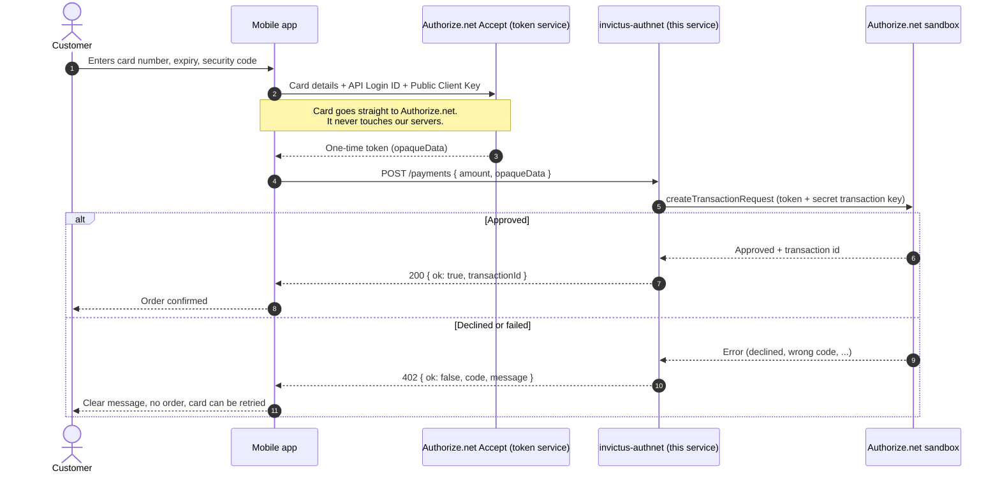

# invictus-authnet

NestJS (TypeScript) service for trying Authorize.net payments against the **sandbox** only.

The app never sends card numbers here. The device turns the card into a one-time token
(Accept.js / Accept mobile SDK, using the non-secret API Login ID and Public Client Key) and
this service charges that token with the secret transaction key, which stays on the server.

## Run

    cp .env.example .env   # add sandbox credentials
    npm run dev
    npm test

## How a mobile app uses it

What lives where:

| Piece | Where it lives | Secret? |
|---|---|---|
| API Login ID and Public Client Key | In the app, used to get the token | No |
| Transaction key | Only in this service's `.env` | **Yes** |
| Card number | Only on the customer's phone until it is swapped for the token | Never stored or sent to us |

The token is single use and expires after about 15 minutes, so the app should call `POST /payments` right after it receives it.

Notes for the app side:
- Authorize.net provides native Accept SDKs for Android and iOS. There is no official Flutter package, so a Flutter app needs a small platform channel to the native SDK, or Accept.js inside a web view.
- Whether the order in the store is created by this service, or by the store itself using the same token, is still open (see INVM-33). If the store creates the order, the app sends the token to the store instead and this service stays a sandbox test tool.

## Endpoints

- `GET /health`
- `POST /payments` with `{ "amount": "10.00", "opaqueData": { "dataDescriptor": "...", "dataValue": "..." } }`
  returns `{ ok: true, transactionId, authCode }`, or 402 with `{ ok: false, code, message }`.

The sandbox URL is fixed in `src/authnet/client.ts`. Nothing here can reach production.
