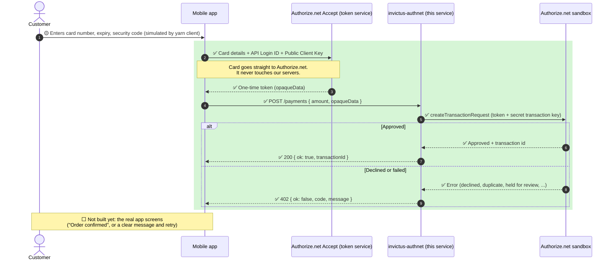

# invictus-authnet

NestJS (TypeScript) service for trying Authorize.net payments against the **sandbox** only.

The app never sends card numbers here. The device turns the card into a one-time token
(Accept.js / Accept mobile SDK, using the non-secret API Login ID and Public Client Key) and
this service charges that token with the secret transaction key, which stays on the server.

## Status

Our side of the integration is done and tested against the Authorize.net **sandbox**. What is left
depends on the store team.

**Done (this service)**
- [x] NestJS service with `GET /health` and `POST /payments`
- [x] Charges a one-time Accept token (`opaqueData`) with the secret transaction key, which stays on the server
- [x] Sandbox only: the URL is fixed in code, so nothing can reach production
- [x] Request validation (class-validator) with clear 400 errors
- [x] Clear results: 200 approved, 402 with the real reason (declined, duplicate `11`, held for review `252`)
- [x] Swagger UI at `/docs`
- [x] Unit and API tests (`yarn test`)
- [x] `yarn client` simulates the mobile app: card -> Accept token -> `POST /payments`, with `--random` cards, names and amounts
- [x] Verified end to end: approved sandbox transactions show up in the merchant dashboard
- [x] Documented: setup, environment, test cards, how to read results

**Not done (needs the store team or the app team)**
- [ ] Agree who creates the store order after approval: this service, or the store using the same token (INVM-33)
- [ ] Real mobile app using the native Accept SDK (Android and iOS), or Accept.js in a web view. `yarn client` only imitates it with plain HTTP calls
- [ ] Customer-facing screens: card form, "order confirmed", retry after a decline
- [ ] Production: a live merchant account, its own credentials, a production endpoint, and a deliberate code change
- [ ] Decide what the store does with payments held for review (`252`), since they are not charged
- [ ] Authentication on `POST /payments` before anything real calls it (it is open today)

## Run

    cp .env.example .env   # add sandbox credentials (see below)
    yarn install
    yarn dev               # http://localhost:$PORT, Swagger UI at /docs
    yarn client            # fake mobile app: sandbox test card -> Accept token -> POST /payments
    yarn test

Other scripts: `yarn build`, `yarn start` (runs the build), `yarn typecheck`.

### Environment

| Variable | Used by | Secret? |
|---|---|---|
| `AUTHNET_API_LOGIN_ID` | API and `yarn client` | No |
| `AUTHNET_TRANSACTION_KEY` | API only | **Yes** |
| `AUTHNET_CLIENT_KEY` | `yarn client` only (the public client key a real app would hold) | No |
| `PORT` | API and `yarn client` | No |

Get the public client key in the sandbox merchant account under **Account > Account and API Settings**
(look for *Manage Public Client Key*; the menu names change now and then). The Authorize.net UI moves
things around, so use its search box if the path above is out of date.

## Trying payments with `yarn client`

`yarn client` plays the part of the mobile app. It sends the card **straight to Authorize.net's sandbox
Accept service** to get a one-time token, then calls this service's `POST /payments` with only that token.
Start `yarn dev` in one terminal and run the client in another.

    yarn client                                       # fixed defaults: Visa 4111..., 10.00
    yarn client --amount 25.50 --card 4007000000027 --exp 1230 --cvv 123 --name "Ada Lovelace"
    yarn client --invoice INV-1001                    # shows up in the Invoice number column
    yarn client --random                              # random card, name, amount, expiry, invoice
    yarn client --random --count 5                    # five payments in a row, with an N/5 summary
    yarn client --random --card 370000000000002       # random, but with one field pinned

Anything you pass explicitly wins over the random value. Flags: `--amount`, `--card`, `--exp` (MMYY),
`--cvv`, `--name`, `--invoice`, `--random`, `--count`, `--api` (default `http://localhost:$PORT`).
The script only logs the last four digits of the card. The name goes to Authorize.net in the token
request; `POST /payments` does not take or store it.

### Sandbox test cards

Use any future expiry (`MMYY`) and any CVV of the right length (4 digits for Amex, 3 for the rest).

| Brand | Number | In `--random`? |
|---|---|---|
| Visa | `4111111111111111` | yes |
| Visa | `4007000000027` | yes |
| Visa | `4012888818888` | no, this account holds it for review (252) |
| Mastercard | `5424000000000015` | yes |
| Mastercard | `2223000010309703` | yes |
| American Express | `370000000000002` | yes |
| Discover | `6011000000000012` | yes |
| JCB | `3088000000000017` | yes |
| Diners Club | `38000000000006` | no, this account declines it (17) |

The two "no" cards still work with `--card` and are useful for exercising the 402 path. Whether a
card type is accepted depends on the merchant account settings, so your results can differ.
Authorize.net's testing guide lists the current numbers and the Test Mode trick for forcing specific
errors (card `4222222222222` with the amount set to the response reason code you want).

### Reading the result

| Response | Meaning |
|---|---|
| `200 { ok: true, transactionId, authCode }` | Approved and captured. It appears under **Unsettled Transactions** in the sandbox dashboard. |
| `402`, code `2` or `17` and similar | Declined, or the card type is not accepted. |
| `402`, code `11` | **Duplicate transaction.** The same card and amount was submitted again within about two minutes. Change the amount or wait. |
| `402`, code `252` | **Held for review.** Authorize.net's fraud filters kept the payment, so it is not charged. See below. |
| `400 { error: "invalid_request", details }` | The request body failed validation. `details` lists each field path and message. |

Gotchas when testing a lot:
- Sending many payments in a short time can trip the sandbox **velocity filter**, and then even good
  cards come back as 252. Held payments show under **Manage Transactions > Unsettled > To Review**.
  Wait a while, or review the filter settings in the Fraud Detection Suite, before assuming the code is
  broken.
- `--random` uses random amounts, so it does not hit the duplicate check. Repeating the same fixed
  `yarn client` run does, because the default card and amount never change.

## How a mobile app uses it

**Legend:** ✅ done and tested against the sandbox (green area), 🟡 simulated by `yarn client`
(there is no real app yet), ⬜ not built yet and left to the app and store teams.

What lives where:

| Piece | Where it lives | Secret? |
|---|---|---|
| API Login ID and Public Client Key | In the app, used to get the token | No |
| Transaction key | Only in this service's `.env` | **Yes** |
| Card number | Only on the customer's phone until it is swapped for the token | Never stored or sent to us |

The token is single use and expires after about 15 minutes, so the app should call `POST /payments` right after it receives it.

Notes for the app side:
- Authorize.net provides native Accept SDKs for Android and iOS. There is no official Flutter package, so a Flutter app needs a small platform channel to the native SDK, or Accept.js inside a web view.
- Whether the order in the store is created by this service, or by the store itself using the same token, is still open (see INVM-33). If the store creates the order, the app sends the token to the store instead and this service stays a sandbox test tool.

## Endpoints

Interactive docs: Swagger UI at `/docs`, OpenAPI JSON at `/docs-json`.

- `GET /health`
- `POST /payments` with `{ "amount": "10.00", "opaqueData": { "dataDescriptor": "...", "dataValue": "..." }, "invoiceNumber": "optional, max 20 chars" }`
  returns `{ ok: true, transactionId, authCode }`, or 402 with `{ ok: false, code, message }`.
  `amount` must have exactly two decimals. Invalid bodies return 400.

The sandbox URL is fixed in `src/authnet/client.ts`. Nothing here can reach production.

## Tooling notes

- Yarn 4 with `nodeLinker: node-modules` (see `.yarnrc.yml`).
- `yarn dev` and `yarn build` compile with swc, with a full type check alongside. Tests use swc too.
- `yarn dev` loads `.env` through Node's `--env-file`. That flag cannot go in `NODE_OPTIONS`.
- Request validation uses class-validator DTOs, which Swagger also reads.
